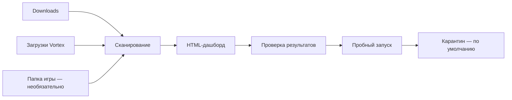

<div align="center">

# Cyberpunk 2077 Mod Auditor

**Разберитесь в архивах модов: найдите дубликаты, посмотрите, что уже есть в игре, и безопасно наведите порядок.**

[](https://github.com/NeR1cH/cyberpunk-mods-helper/releases/latest)


**Сканирование → наглядный HTML-отчёт → проверка → очистка в карантин**

<p align="center">
  
</p>

</div>

> Это локальный помощник для учёта архивов Cyberpunk 2077. Он **не устанавливает и не распаковывает моды** и не заменяет Vortex. Обычная проверка работает без API-ключа и дополнительных Python-пакетов.

## Содержание

- [Возможности](#возможности)
- [Быстрый старт](#быстрый-старт)
- [Настройка](#настройка)
- [Как читать отчёт](#как-читать-отчёт)
- [Безопасная очистка](#безопасная-очистка)
- [ИИ и Nexus Mods](#ии-и-nexus-mods)
- [Чёрный список](#чёрный-список)
- [Конфиденциальность и ограничения](#конфиденциальность-и-ограничения)
- [Дополнительные библиотеки](#дополнительные-библиотеки)
- [Устранение неполадок](#устранение-неполадок)
- [Для разработчиков](#для-разработчиков)

## Возможности

| | Что делает программа |
|---|---|
| 🔎 **Сканирует архивы** | Находит `.zip`, `.7z` и `.rar` в папках Downloads и загрузок Vortex. |
| 🧩 **Группирует моды** | Использует Nexus Mod ID и названия архивов, чтобы объединять версии одного мода. |
| 🪞 **Находит точные копии** | Проверяет размер и SHA-256, а не только имя файла. |
| 🕰️ **Показывает старые версии** | Сравнивает архивы по распознанному ID, имени, версии и дате в названии. Это подсказка, а не проверка совместимости. |
| 🎮 **Показывает файлы в игре** | Отдельно проверяет известные папки Cyberpunk 2077, не смешивая их с архивами загрузок. |
| 📊 **Создаёт HTML-дашборд** | Даёт фильтры, сводку по источникам, ссылки для поиска и инструменты для чёрного списка. |
| 🧹 **Помогает очистить Downloads** | Сначала проверяет список без изменений; по умолчанию перемещает выбранные файлы в карантин. |
| 🤖 **Поддерживает ИИ по желанию** | Может распознавать названия и анализировать публичные страницы Nexus через OpenRouter. |

### Пример дашборда

<p align="center">
  
</p>



### Что стало надёжнее в версии 1.1.0

- Большие операции сканирования, группировки, AI-анализа и очистки разделены на более понятные части и покрыты отдельными проверками.
- Перед очисткой программа заново проверяет файлы и, для точных копий, сравнивает SHA-256 с сохраняемой копией. Без `--apply` файлы не меняются.
- Некорректные даты в кэше и счётчике запросов не принимаются за достоверные.
- Успешные результаты анализа сохраняются по мере обработки партий, поэтому уже выполненную работу не нужно начинать заново при следующем запуске.
- В обычном режиме не требуются новые Python-зависимости.

## Быстрый старт

**Нужно:** Windows, Python **3.10 или новее**, папка с архивами и браузер. Для обычного сканирования интернет и API-ключ не нужны.

1. [Скачайте ZIP-архив проекта](https://github.com/NeR1cH/cyberpunk-mods-helper/archive/refs/heads/main.zip) и распакуйте его.
2. Откройте папку проекта и запустите `start.bat`.
3. При первом запуске появится `config.json`, а программа остановится — это ожидаемо.
4. Откройте `config.json`, укажите пути к папкам с архивами и сохраните файл.
5. Запустите `start.bat` ещё раз. После сканирования откройте [http://localhost:8000](http://localhost:8000).

Оставьте окно `start.bat` открытым, пока пользуетесь дашбордом: оно запускает локальный сервер, нужный для интерактивных кнопок.

## Настройка

`start.bat` создаёт `config.json` из `config.example.json`, только если настройки ещё не существуют. Существующий файл он не перезаписывает. Пример основных параметров:

```json
{
  "downloads": "C:\\Mods\\Downloads",
  "vortex": "D:\\VortexMods\\cyberpunk2077",
  "game": "C:\\Games\\Cyberpunk 2077",
  "ai": {
    "api_key": "YOUR_OPENROUTER_API_KEY"
  }
}
```

Замените примеры путей на свои. В JSON обратный слэш записывается как `\\`.

| Параметр | Значение |
|---|---|
| `downloads` | Папка с архивами, скачанными вручную или через Nexus. |
| `vortex` | Папка **загрузок** Vortex. Это не папка развернутых модов или staging. |
| `game` | Папка установленной игры. Можно убрать этот параметр: программа попробует найти игру в Steam. |
| `ai.api_key` | Необязательный ключ OpenRouter. Можно вместо него задать `OPENROUTER_API_KEY`; переменная среды имеет приоритет. |

Укажите хотя бы одну существующую папку загрузок; для сравнения источников лучше настроить `downloads` и `vortex`. Дополнительно поддерживаются `out` (имя HTML-отчёта), `quarantine` (папка карантина) и `max_mod_id` (верхняя граница распознаваемого Nexus ID). Аргументы командной строки имеют приоритет над настройками файла.

Если не хотите использовать ИИ, оставьте ключ-заглушку или удалите блок `ai`. **Не помещайте настоящий API-ключ в `config.example.json` и не публикуйте `config.json`.**

### Ручной запуск

Команды выполняются из папки проекта:

```powershell
# Сканировать и создать отчёт, не открывая его автоматически
python nexus_links.py scan --no-open

# Передать пути вручную
python nexus_links.py scan --downloads "C:\Mods\Downloads" --vortex "D:\Vortex\cyberpunk2077"

# Необязательное распознавание названий через OpenRouter
python nexus_links.py scan --ai

# Запустить локальный просмотрщик отчёта
python server.py
```

Результат по умолчанию сохраняется в `mod_audit_dashboard.html` в папке проекта. Если открыть этот файл двойным щелчком, отчёт будет виден, но интерактивные кнопки требуют запущенного `server.py`.

## Как читать отчёт

### Группы и файлы — не одно и то же

- **Архив** — один файл `.zip`, `.7z` или `.rar`.
- **Группа** — один или несколько архивов, объединённых по ID или названию. Несколько версий одного мода могут считаться одной группой.

Поэтому число групп обычно отличается от числа архивов. ИИ может помочь распознать ID, из-за чего группы иногда меняются между запусками.

### Основные фильтры

| Фильтр | Что показывает |
|---|---|
| **Точные копии** | Архивы, у которых совпадает SHA-256. |
| **Старые версии** | Похожие версии одного мода, найденные в Downloads. |
| **Обновить в Vortex** | В Downloads найден архив новее версии из папки загрузок Vortex. Само обновление выполняется вручную через Vortex. |
| **Опасные** | ID из встроенного или вашего списка. Метка не означает, что программа проверила файл на вирусы. |
| **Из Nexus Downloads** | Группы, у которых есть архив в `downloads`, включая группы с копией в Vortex. |
| **Моды в Vortex Downloads** | Группы, найденные только в папке загрузок Vortex. |
| **Локальные в игре** | Файлы в известных папках установленной игры — это отдельный список, не архивы. |

Важно различать **место, где найден архив**, **инструкцию автора** и **совместимость с Vortex**. Метки `Downloads` и `Vortex` показывают, в какой папке лежит архив; они сами по себе не говорят, установлен ли мод через Vortex. Ручные шаги в описании автора тоже не означают, что Vortex несовместим. В AI-анализе эти сведения разделены: подтверждение автора, неподтверждённое предположение ИИ, явное отрицание поддержки или неизвестный статус. Процент уверенности ИИ относится к разбору, а не является вероятностью совместимости. Вкладка **«Локальные в игре»** показывает найденные файлы в папках игры. Отчёт не перемещает архивы и не устанавливает моды.

Сканер проверяет известные каталоги игры: `archive/pc/mod`, `archive/pc/patch`, `r6/scripts`, `r6/tweaks`, `red4ext/plugins`, `bin/x64/plugins` и `mods`. Это приблизительный обзор: он не гарантирует обнаружение всех модов и не подтверждает, что они работают.

Определение старых версий — эвристика по именам, ID, версии и/или дате в имени файла. Оно не проверяет совместимость мода с текущей версией игры. Карточки фреймворков тоже проверяют наличие известных файлов, а не работоспособность игры.

## Безопасная очистка

Программа ничего не удаляет безвозвратно: очистка всегда идёт по цепочке **предпросмотр → подтверждение → карантин**. Прямого удаления и BAT-скрипта в дашборде больше нет.

Сначала выберите файлы. В дашборде на вкладке точных копий или старых версий отметьте галочками файлы в Downloads. По умолчанию отмечены только точные копии; старые версии отмечаются вручную или кнопкой «Выбрать все старые». Счётчик «Выбрано» показывает число файлов и их размер.

### Из дашборда

1. Нажмите **«Перенести выбранное в карантин»**. Откроется предпросмотр: сервер заново проверяет каждый файл и показывает, что будет перенесено, а что пропущено и почему. На этом шаге ничего не меняется.
2. Если список верный, нажмите **«Применить»**. Перед переносом файлы проверяются ещё раз; в конце окно покажет папку запуска и журнал.

Кнопка работает, только когда дашборд открыт по адресу `http://localhost:8000` и в `config.json` задана папка `downloads`. Проверка точных копий пересчитывает SHA-256, поэтому для больших архивов предпросмотр занимает время.

### Из командной строки

1. Нажмите **«Экспорт JSON для clean»** — в `selection.json` попадёт только отмеченное.
2. Сначала запустите проверку — она ничего не перемещает:

   ```powershell
   python nexus_links.py clean "C:\путь\к\selection.json"
   ```

3. Проверьте перечень кандидатов и сохраняемых копий.
4. Если всё верно, добавьте `--apply`:

   ```powershell
   python nexus_links.py clean "C:\путь\к\selection.json" --apply
   ```

### Что происходит с файлами

В обоих случаях действуют одни и те же проверки. По умолчанию файлы перемещаются в `_mod_audit_quarantine` внутри Downloads. Для каждого запуска создаётся отдельная папка и журнал. Папка карантина при сканировании пропускается, в том числе когда в `quarantine` задано своё имя внутри Downloads. Программа пропускает файл, если он изменился или исчез, оказался вне Downloads либо для него не найдена сохраняемая копия. У точных копий SHA-256 проверяется повторно.

Перемещение в Корзину доступно только из командной строки и требует необязательную библиотеку `send2trash`:

```powershell
python nexus_links.py clean "C:\путь\к\selection.json" --apply --mode trash
```

Флаг `--no-verify` отключает повторную проверку SHA-256 точных копий; без особой причины не используйте его. Экспортированный `selection.json` содержит локальные пути — храните его как личный файл.

## ИИ и Nexus Mods

ИИ не обязателен. Сканирование, поиск дубликатов, SHA-256 и обычный отчёт работают без него.

| Режим | Что делает | Требует ключ OpenRouter |
|---|---|---:|
| `--ai` | Помогает распознать неизвестные названия модов и найти их на Nexus. По умолчанию анализирует моды без распознанного ID. | Да |
| `--nexus-details` | Получает публичную выдержку с указаниями автора по установке, без AI-анализа. | Нет |
| `--nexus-analyze` | Получает публичные данные страницы Nexus и просит модель сделать русское резюме, выделить инструкцию автора и отдельно оценить поддержку Vortex. | Да |
| `ai-models` | Показывает доступные сейчас бесплатные модели OpenRouter. | Нет |

Примеры:

```powershell
python nexus_links.py scan --ai
python nexus_links.py scan --nexus-details
python nexus_links.py scan --nexus-analyze
python nexus_links.py ai-models
```

Для анализа страниц сначала создайте ключ на [странице OpenRouter](https://openrouter.ai/keys) и задайте его в `config.json` или переменную `OPENROUTER_API_KEY`. Список моделей меняется; актуальные бесплатные варианты можно получить командой `ai-models` и указать в `ai.models`, например:

```json
{
  "ai": {
    "api_key": "YOUR_OPENROUTER_API_KEY",
    "models": ["provider/model:free"]
  }
}
```

**Что отправляется внешним сервисам:**

- Для распознавания названий OpenRouter получает названия архивов и выбранные имена файлов внутри архивов — не сами архивы и не локальные пути.
- Для `--nexus-analyze` OpenRouter получает поля публичной страницы Nexus (например, название, описание, категорию и теги). Локальные пути и названия ваших архивов этой функции не нужны.
- `--nexus-details` читает публичную страницу Nexus без OpenRouter. Для этого режима нужен доступ к интернету.

### Лимиты запросов к OpenRouter

У приложения есть собственный предохранитель. Это не квота OpenRouter: лимиты аккаунта и моделей задаются на стороне сервиса отдельно.

| Что ограничивается | Настройка | По умолчанию |
|---|---|---:|
| Запросы за UTC-сутки (счётчик в `openrouter_usage.json`) | `ai.daily_budget` в `config.json` | 10 |
| Запросы за один запуск | `ai.per_run_budget` в `config.json` | равен суточному |
| Пачки распознавания названий за раунд | `--ai-max-requests`, затем `ai.max_requests` в `config.json` | 8 |

Как это работает:

- Порядок приоритетов везде один: аргумент командной строки → `config.json` → значение по умолчанию. У суточного лимита и лимита за запуск аргументов нет, они задаются только в `config.json`.
- Действует самое строгое ограничение. Например, `--ai-max-requests 8` при `ai.per_run_budget` 2 отправит не больше двух запросов.
- Раунд — это одна порция работы ИИ: пачки названий и анализ нескольких страниц Nexus. Обычный запуск выполняет один раунд. С флагом `--ai-until-budget` раунды повторяются в том же запуске, пока не кончится лимит или работа; папки при этом сканируются и отчёт создаётся один раз. Так работает `start.bat`.
- Суточный лимит и лимит за запуск общие для распознавания названий (`--ai`) и анализа страниц Nexus (`--nexus-analyze`).
- Считается каждая отправка запроса. Если модель не ответила и программа переключилась на следующую из списка, это ещё один запрос.
- В начале запуска с ИИ программа пишет в консоль, сколько запросов разрешено и какое ограничение сработало.
- Значение `0` отключает запросы. Неверное значение (отрицательное, дробное, строка) заменяется значением по умолчанию с предупреждением.

```json
{
  "ai": {
    "daily_budget": 10,
    "per_run_budget": 10
  }
}
```

Успешные результаты кэшируются. `--ai-refresh` просит выполнить анализ повторно и может расходовать запросы; для обновления ранее сохранённых рекомендаций Nexus используйте его вместе с `--nexus-analyze`. Старый кэш сохраняется, но до повторного анализа статус Vortex у таких записей будет «неизвестно».

Nexus отмечает используемый API-адрес страниц как экспериментальный, поэтому он может измениться. AI-рекомендации и процент уверенности — подсказки модели, а не гарантия корректности, безопасности или совместимости. Статус «возможно» не подтверждён автором; проверяйте источник перед установкой. Программа не устанавливает моды автоматически.

## Чёрный список

Встроенные и пользовательские записи помогают помечать моды по Nexus ID. Чтобы добавить запись, откройте дашборд через `http://localhost:8000`, нажмите **«Добавить в мой список»** у мода с распознанным ID, укажите причину и дождитесь подтверждения. Пользовательские записи сохраняются в `blacklist.json`. Удалить свою запись можно кнопкой **«Убрать из моего списка»**.

Если у записи нет распознанного ID, её можно внести вручную:

```json
{
  "12345": {
    "reason": "Причина пометки"
  }
}
```

Наличие ID в списке означает совпадение с вашей пометкой, а не автоматическую проверку содержимого архива.

## Конфиденциальность и ограничения

- Не публикуйте `config.json`, API-ключ, `blacklist.json`, кэши, отчёт и экспорт очистки: они могут содержать личные данные или локальные пути.
- Исходные архивы не отправляются ИИ, но названия архивов и выбранных файлов могут уйти в OpenRouter при включённом `--ai`.
- Дашборд-сервер слушает только `127.0.0.1` и принимает запросы только от своей страницы: проверяются адрес (`localhost:8000` или `127.0.0.1:8000`), источник запроса и одноразовый токен, который сервер вписывает в страницу при каждом запуске. Другие сайты, открытые в том же браузере, обратиться к нему не могут. Не открывайте сервер для внешней сети.
- Кнопка «В папке» открывает в Проводнике только то, что лежит внутри папок `downloads`, `vortex`, `game` и карантина из `config.json`.
- Проверка дубликатов подтверждает совпадение файлов, но не безопасность модов. Поиск старых версий, оценка ИИ и наличие файлов фреймворков не подтверждают совместимость или исправность игры.
- При очистке сначала используйте режим проверки без `--apply`, а затем карантин. Не удаляйте карантин, пока не убедитесь, что сохранены нужные файлы.

## Дополнительные библиотеки

Для обычного сканирования устанавливать пакеты не нужно. Дополнительные библиотеки нужны только для отдельных функций:

| Пакет | Для чего нужен |
|---|---|
| `py7zr` | Чтение имён файлов внутри архивов `.7z` для AI-контекста. |
| `rarfile` | Чтение имён файлов внутри `.rar`; может также потребоваться системная утилита для работы с RAR. |
| `send2trash` | Режим очистки `--mode trash`. Без него используйте карантин. |

Установить нужные пакеты можно командой:

```powershell
py -m pip install py7zr rarfile send2trash
```

## Устранение неполадок

| Проблема | Что проверить |
|---|---|
| `python` не найден | Установите Python 3.10+ с добавлением в `PATH`, откройте новое окно терминала. Для ручных команд можно попробовать `py -3`; `start.bat` использует `python`. |
| Не найдены папки | Проверьте `downloads` и `vortex` в `config.json`. Хотя бы одна указанная папка должна существовать. |
| Дашборд открылся, но кнопки не работают | Откройте его по адресу `http://localhost:8000` и оставьте окно `start.bat` открытым. HTML, открытый двойным щелчком, не может обращаться к локальному серверу. |
| ИИ не отвечает | Проверьте API-ключ, интернет, доступность модели и лимиты. Без ключа обычное сканирование продолжит работать. |
| В `.7z` или `.rar` нет имён файлов для ИИ | Установите `py7zr` или `rarfile`. Поиск архивов, группировка и SHA-256 от них не зависят. |
| Игра не обнаружена | Укажите `game` в `config.json`. Без папки игры сканирование архивов продолжится, но проверка файлов игры будет недоступна. |
| `clean` пропускает файл | Это может означать, что файл изменился после экспорта, исчез, находится вне Downloads или не найдена сохраняемая копия. Просканируйте папки и создайте новый экспорт. |
| Кнопки пишут «Сервер был перезапущен… обновите страницу» | Токен на странице устарел: сервер перезапускали, пока вкладка была открыта, или отчёт создан прежней версией. Нажмите F5; если не помогло — запустите сканирование заново. |
| «В папке» отвечает отказом | Путь лежит вне папок `downloads`, `vortex`, `game` и карантина из `config.json`. Проверьте настройки; путь можно скопировать кнопкой «Путь». |
| «Перенести в карантин» сообщает, что сервер не запущен | Дашборд открыт как файл или окно `start.bat` закрыто. Откройте `http://localhost:8000` либо используйте «Экспорт JSON для clean» и команду `clean`. |
| «Очистка из дашборда отключена» | В `config.json` не задана папка `downloads`. Сервер не подставляет вместо неё системную папку «Загрузки»: укажите путь и перезапустите `start.bat`. |
| «Список изменился после предпросмотра» | Сервер переносит только тот список, который показал в предпросмотре. Закройте окно и откройте предпросмотр заново. |
| Старый отчёт пишет, что удалить файлы не удалось | Отчёт создан прежней версией, а прямое удаление убрано (сервер отвечает `410`). Запустите сканирование заново, чтобы получить новый дашборд. |
| Рядом с кэшем появился файл `*.corrupt-<дата>.json` | Кэш не удалось прочитать (например, запись оборвалась при сбое питания). Программа не затирает такой файл, а переименовывает его и начинает новый кэш. Если в старом файле нет ничего нужного, его можно удалить вручную. |
| Повторное сканирование снова долго считает SHA-256 | Хеши хранятся в `mod_cache.json` рядом с программой и берутся оттуда, пока у файла не изменились размер и время изменения. Если файл удалён или недоступен для записи, хеши считаются заново. Удалять его безопасно: он пересоздаётся. |
| В консоли сломана кириллица | Вручную выполните `chcp 65001`. В `start.bat` переключение на UTF-8 уже включено. |

## Для разработчиков

Проект не требует обязательных сторонних Python-пакетов. Запуск тестов:

```powershell
python -m unittest discover -s tests -q
```

Локальные настройки, кэши и сгенерированный отчёт не следует добавлять в Git. Для примеров конфигурации используйте `config.example.json`, оставляя API-ключ заглушкой.

Подробные проверки перед выпуском и правила работы с локальными данными описаны в [CONTRIBUTING.md](CONTRIBUTING.md).
