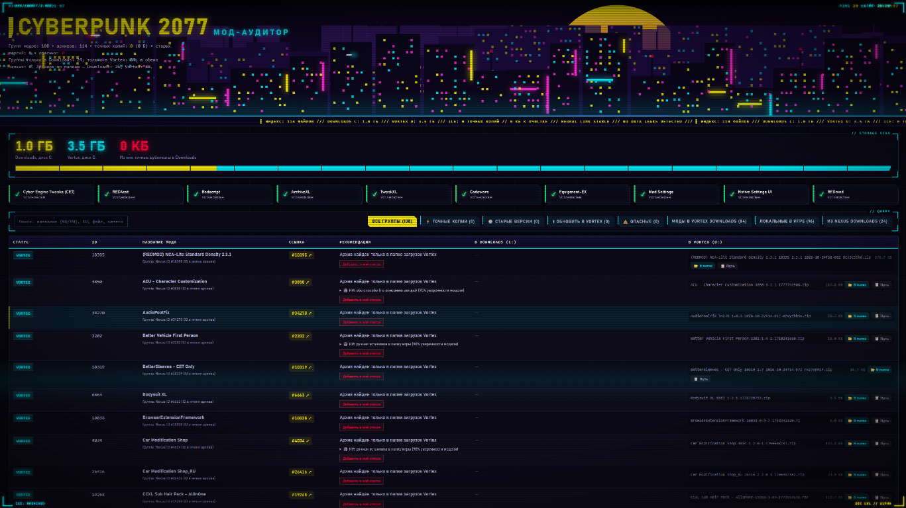
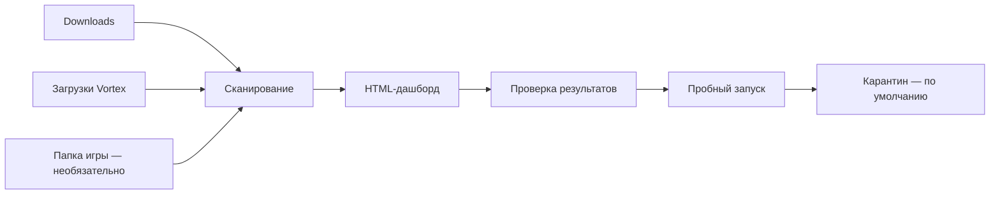

<div align="center">

# Cyberpunk 2077 Mod Auditor

**Разберитесь в архивах модов: найдите дубликаты, посмотрите, что уже есть в игре, и безопасно наведите порядок.**

[](https://github.com/NeR1cH/cyberpunk-mods-helper/releases/latest)


**Сканирование → наглядный HTML-отчёт → проверка → очистка в карантин**

<p align="center">
  
</p>

</div>

> Это локальный помощник для учёта архивов Cyberpunk 2077. Он **не устанавливает и не распаковывает моды** и не заменяет Vortex. Обычная проверка работает без API-ключа и дополнительных Python-пакетов.

## Содержание

- [Возможности](#возможности)
- [Быстрый старт](#быстрый-старт)
- [Настройка](#настройка)
- [Как читать отчёт](#как-читать-отчёт)
- [Безопасная очистка](#безопасная-очистка)
- [ИИ и Nexus Mods](#ии-и-nexus-mods)
- [Чёрный список](#чёрный-список)
- [Конфиденциальность и ограничения](#конфиденциальность-и-ограничения)
- [Дополнительные библиотеки](#дополнительные-библиотеки)
- [Устранение неполадок](#устранение-неполадок)
- [Для разработчиков](#для-разработчиков)

## Возможности

| | Что делает программа |
|---|---|
| 🔎 **Сканирует архивы** | Находит `.zip`, `.7z` и `.rar` в папках Downloads и загрузок Vortex. |
| 🧩 **Группирует моды** | Использует Nexus Mod ID и названия архивов, чтобы объединять версии одного мода. |
| 🪞 **Находит точные копии** | Проверяет размер и SHA-256, а не только имя файла. |
| 🕰️ **Показывает старые версии** | Сравнивает архивы по распознанному ID, имени, версии и дате в названии. Это подсказка, а не проверка совместимости. |
| 🎮 **Показывает файлы в игре** | Отдельно проверяет известные папки Cyberpunk 2077, не смешивая их с архивами загрузок. |
| 📊 **Создаёт HTML-дашборд** | Даёт фильтры, сводку по источникам, ссылки для поиска и инструменты для чёрного списка. |
| 🧹 **Помогает очистить Downloads** | Сначала проверяет список без изменений; по умолчанию перемещает выбранные файлы в карантин. |
| 🤖 **Поддерживает ИИ по желанию** | Может распознавать названия и анализировать публичные страницы Nexus через OpenRouter. |



### Что стало надёжнее в версии 1.1.0

- Большие операции сканирования, группировки, AI-анализа и очистки разделены на более понятные части и покрыты отдельными проверками.
- Перед очисткой программа заново проверяет файлы и, для точных копий, сравнивает SHA-256 с сохраняемой копией. Без `--apply` файлы не меняются.
- Некорректные даты в кэше и счётчике запросов не принимаются за достоверные.
- Успешные результаты анализа сохраняются по мере обработки партий, поэтому уже выполненную работу не нужно начинать заново при следующем запуске.
- В обычном режиме не требуются новые Python-зависимости.

## Быстрый старт

**Нужно:** Windows, Python **3.10 или новее**, папка с архивами и браузер. Для обычного сканирования интернет и API-ключ не нужны.

1. [Скачайте ZIP-архив проекта](https://github.com/NeR1cH/cyberpunk-mods-helper/archive/refs/heads/main.zip) и распакуйте его.
2. Откройте папку проекта и запустите `start.bat`.
3. При первом запуске появится `config.json`, а программа остановится — это ожидаемо.
4. Откройте `config.json`, укажите пути к папкам с архивами и сохраните файл.
5. Запустите `start.bat` ещё раз. После сканирования откройте [http://localhost:8000](http://localhost:8000).

Оставьте окно `start.bat` открытым, пока пользуетесь дашбордом: оно запускает локальный сервер, нужный для интерактивных кнопок.

## Настройка

`start.bat` создаёт `config.json` из `config.example.json`, только если настройки ещё не существуют. Существующий файл он не перезаписывает. Пример основных параметров:

```json
{
  "downloads": "C:\\Mods\\Downloads",
  "vortex": "D:\\VortexMods\\cyberpunk2077",
  "game": "C:\\Games\\Cyberpunk 2077",
  "ai": {
    "api_key": "YOUR_OPENROUTER_API_KEY"
  }
}
```

Замените примеры путей на свои. В JSON обратный слэш записывается как `\\`.

| Параметр | Значение |
|---|---|
| `downloads` | Папка с архивами, скачанными вручную или через Nexus. |
| `vortex` | Папка **загрузок** Vortex. Это не папка развернутых модов или staging. |
| `game` | Папка установленной игры. Можно убрать этот параметр: программа попробует найти игру в Steam. |
| `ai.api_key` | Необязательный ключ OpenRouter. Можно вместо него задать `OPENROUTER_API_KEY`; переменная среды имеет приоритет. |

Укажите хотя бы одну существующую папку загрузок; для сравнения источников лучше настроить `downloads` и `vortex`. Дополнительно поддерживаются `out` (имя HTML-отчёта), `quarantine` (папка карантина) и `max_mod_id` (верхняя граница распознаваемого Nexus ID). Аргументы командной строки имеют приоритет над настройками файла.

Если не хотите использовать ИИ, оставьте ключ-заглушку или удалите блок `ai`. **Не помещайте настоящий API-ключ в `config.example.json` и не публикуйте `config.json`.**

### Ручной запуск

Команды выполняются из папки проекта:

```powershell
# Сканировать и создать отчёт, не открывая его автоматически
python nexus_links.py scan --no-open

# Передать пути вручную
python nexus_links.py scan --downloads "C:\Mods\Downloads" --vortex "D:\Vortex\cyberpunk2077"

# Необязательное распознавание названий через OpenRouter
python nexus_links.py scan --ai

# Запустить локальный просмотрщик отчёта
python server.py
```

Результат по умолчанию сохраняется в `mod_audit_dashboard.html` в папке проекта. Если открыть этот файл двойным щелчком, отчёт будет виден, но интерактивные кнопки требуют запущенного `server.py`.

## Как читать отчёт

### Группы и файлы — не одно и то же

- **Архив** — один файл `.zip`, `.7z` или `.rar`.
- **Группа** — один или несколько архивов, объединённых по ID или названию. Несколько версий одного мода могут считаться одной группой.

Поэтому число групп обычно отличается от числа архивов. ИИ может помочь распознать ID, из-за чего группы иногда меняются между запусками.

### Основные фильтры

| Фильтр | Что показывает |
|---|---|
| **Точные копии** | Архивы, у которых совпадает SHA-256. |
| **Старые версии** | Похожие версии одного мода, найденные в Downloads. |
| **Обновить в Vortex** | В Downloads найден архив новее версии из папки загрузок Vortex. Само обновление выполняется вручную через Vortex. |
| **Опасные** | ID из встроенного или вашего списка. Метка не означает, что программа проверила файл на вирусы. |
| **Из Nexus Downloads** | Группы, у которых есть архив в `downloads`, включая группы с копией в Vortex. |
| **Моды в Vortex Downloads** | Группы, найденные только в папке загрузок Vortex. |
| **Локальные в игре** | Файлы в известных папках установленной игры — это отдельный список, не архивы. |

Важно различать **место, где найден архив**, и **способ установки мода**. Метки `Downloads` и `Vortex` показывают, в какой папке лежит архив; они сами по себе не говорят, установлен ли мод через Vortex и совместим ли он с менеджером. Вкладка **«Локальные в игре»** показывает найденные файлы в папках игры. Рекомендация по установке — отдельная подсказка по данным Nexus; если в описании автора нет ясного ответа, способ остаётся неопределённым. Отчёт не перемещает архивы и не устанавливает моды.

Сканер проверяет известные каталоги игры: `archive/pc/mod`, `archive/pc/patch`, `r6/scripts`, `r6/tweaks`, `red4ext/plugins`, `bin/x64/plugins` и `mods`. Это приблизительный обзор: он не гарантирует обнаружение всех модов и не подтверждает, что они работают.

Определение старых версий — эвристика по именам, ID, версии и/или дате в имени файла. Оно не проверяет совместимость мода с текущей версией игры. Карточки фреймворков тоже проверяют наличие известных файлов, а не работоспособность игры.

## Безопасная очистка

Для очистки используется JSON, экспортированный из дашборда. Рекомендуемый порядок:

1. В дашборде выберите точные копии или старые версии в Downloads и нажмите **«Экспорт JSON для clean»**.
2. Сначала запустите проверку — она ничего не перемещает:

   ```powershell
   python nexus_links.py clean "C:\путь\к\selection.json"
   ```

3. Проверьте перечень кандидатов и сохраняемых копий.
4. Если всё верно, добавьте `--apply`:

   ```powershell
   python nexus_links.py clean "C:\путь\к\selection.json" --apply
   ```

По умолчанию файлы перемещаются в `_mod_audit_quarantine` внутри Downloads. Для каждого запуска создаётся отдельная папка и журнал. Программа пропускает файл, если он изменился или исчез, оказался вне Downloads либо для него не найдена сохраняемая копия. У точных копий SHA-256 проверяется повторно.

Перемещение в Корзину доступно отдельно и требует необязательную библиотеку `send2trash`:

```powershell
python nexus_links.py clean "C:\путь\к\selection.json" --apply --mode trash
```

Флаг `--no-verify` отключает повторную проверку SHA-256 точных копий; без особой причины не используйте его. Экспортированный `selection.json` содержит локальные пути — храните его как личный файл.

## ИИ и Nexus Mods

ИИ не обязателен. Сканирование, поиск дубликатов, SHA-256 и обычный отчёт работают без него.

| Режим | Что делает | Требует ключ OpenRouter |
|---|---|---:|
| `--ai` | Помогает распознать неизвестные названия модов и найти их на Nexus. По умолчанию анализирует моды без распознанного ID. | Да |
| `--nexus-details` | Получает публичную выдержку с указаниями автора по установке, без AI-анализа. | Нет |
| `--nexus-analyze` | Получает публичные данные страницы Nexus и просит модель сделать русское резюме и рекомендацию по способу установки. | Да |
| `ai-models` | Показывает доступные сейчас бесплатные модели OpenRouter. | Нет |

Примеры:

```powershell
python nexus_links.py scan --ai
python nexus_links.py scan --nexus-details
python nexus_links.py scan --nexus-analyze
python nexus_links.py ai-models
```

Для анализа страниц сначала создайте ключ на [странице OpenRouter](https://openrouter.ai/keys) и задайте его в `config.json` или переменную `OPENROUTER_API_KEY`. Список моделей меняется; актуальные бесплатные варианты можно получить командой `ai-models` и указать в `ai.models`, например:

```json
{
  "ai": {
    "api_key": "YOUR_OPENROUTER_API_KEY",
    "models": ["provider/model:free"]
  }
}
```

**Что отправляется внешним сервисам:**

- Для распознавания названий OpenRouter получает названия архивов и выбранные имена файлов внутри архивов — не сами архивы и не локальные пути.
- Для `--nexus-analyze` OpenRouter получает поля публичной страницы Nexus (например, название, описание, категорию и теги). Локальные пути и названия ваших архивов этой функции не нужны.
- `--nexus-details` читает публичную страницу Nexus без OpenRouter. Для этого режима нужен доступ к интернету.

Приложение ограничивает OpenRouter максимумом **10 попыток за UTC-сутки** и **2 попытками на один процесс**. Это внутренний предохранитель, а не квота OpenRouter; лимиты аккаунта и моделей задаются отдельно. Успешные результаты кэшируются. `--ai-refresh` просит выполнить анализ повторно и может расходовать запросы.

Nexus отмечает используемый API-адрес страниц как экспериментальный, поэтому он может измениться. AI-рекомендации и процент уверенности — подсказки модели, а не гарантия корректности, безопасности или совместимости. Программа не устанавливает моды автоматически.

## Чёрный список

Встроенные и пользовательские записи помогают помечать моды по Nexus ID. Чтобы добавить запись, откройте дашборд через `http://localhost:8000`, нажмите **«Добавить в мой список»** у мода с распознанным ID, укажите причину и дождитесь подтверждения. Пользовательские записи сохраняются в `blacklist.json`. Удалить свою запись можно кнопкой **«Убрать из моего списка»**.

Если у записи нет распознанного ID, её можно внести вручную:

```json
{
  "12345": {
    "reason": "Причина пометки"
  }
}
```

Наличие ID в списке означает совпадение с вашей пометкой, а не автоматическую проверку содержимого архива.

## Конфиденциальность и ограничения

- Не публикуйте `config.json`, API-ключ, `blacklist.json`, кэши, отчёт и экспорт очистки: они могут содержать личные данные или локальные пути.
- Исходные архивы не отправляются ИИ, но названия архивов и выбранных файлов могут уйти в OpenRouter при включённом `--ai`.
- Дашборд-сервер предназначен для локального использования на `localhost`. Не открывайте его для внешней сети без необходимости.
- Проверка дубликатов подтверждает совпадение файлов, но не безопасность модов. Поиск старых версий, оценка ИИ и наличие файлов фреймворков не подтверждают совместимость или исправность игры.
- При очистке сначала используйте режим проверки без `--apply`, а затем карантин. Не удаляйте карантин, пока не убедитесь, что сохранены нужные файлы.

## Дополнительные библиотеки

Для обычного сканирования устанавливать пакеты не нужно. Дополнительные библиотеки нужны только для отдельных функций:

| Пакет | Для чего нужен |
|---|---|
| `py7zr` | Чтение имён файлов внутри архивов `.7z` для AI-контекста. |
| `rarfile` | Чтение имён файлов внутри `.rar`; может также потребоваться системная утилита для работы с RAR. |
| `send2trash` | Режим очистки `--mode trash`. Без него используйте карантин. |

Установить нужные пакеты можно командой:

```powershell
py -m pip install py7zr rarfile send2trash
```

## Устранение неполадок

| Проблема | Что проверить |
|---|---|
| `python` не найден | Установите Python 3.10+ с добавлением в `PATH`, откройте новое окно терминала. Для ручных команд можно попробовать `py -3`; `start.bat` использует `python`. |
| Не найдены папки | Проверьте `downloads` и `vortex` в `config.json`. Хотя бы одна указанная папка должна существовать. |
| Дашборд открылся, но кнопки не работают | Откройте его по адресу `http://localhost:8000` и оставьте окно `start.bat` открытым. HTML, открытый двойным щелчком, не может обращаться к локальному серверу. |
| ИИ не отвечает | Проверьте API-ключ, интернет, доступность модели и лимиты. Без ключа обычное сканирование продолжит работать. |
| В `.7z` или `.rar` нет имён файлов для ИИ | Установите `py7zr` или `rarfile`. Поиск архивов, группировка и SHA-256 от них не зависят. |
| Игра не обнаружена | Укажите `game` в `config.json`. Без папки игры сканирование архивов продолжится, но проверка файлов игры будет недоступна. |
| `clean` пропускает файл | Это может означать, что файл изменился после экспорта, исчез, находится вне Downloads или не найдена сохраняемая копия. Просканируйте папки и создайте новый экспорт. |
| В консоли сломана кириллица | Вручную выполните `chcp 65001`. В `start.bat` переключение на UTF-8 уже включено. |

## Для разработчиков

Проект не требует обязательных сторонних Python-пакетов. Запуск тестов:

```powershell
python -m unittest discover -s tests -q
```

Локальные настройки, кэши и сгенерированный отчёт не следует добавлять в Git. Для примеров конфигурации используйте `config.example.json`, оставляя API-ключ заглушкой.
